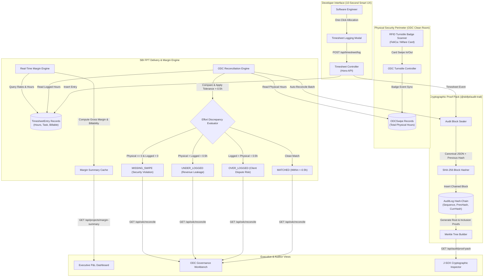
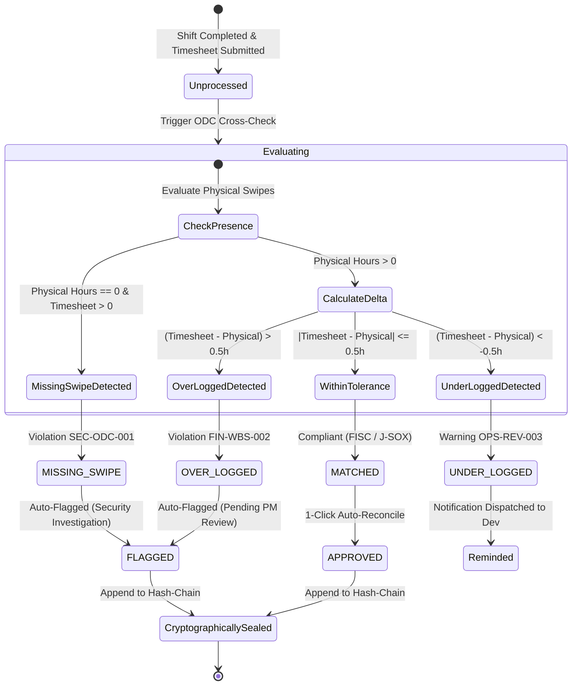
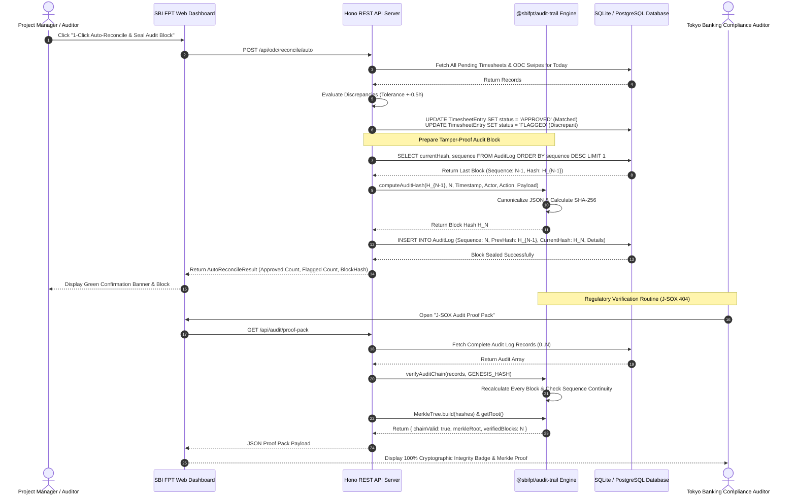
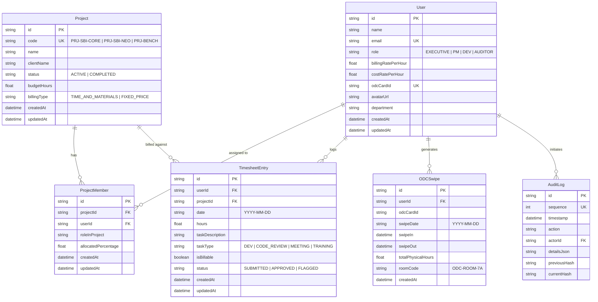

# Software Requirements Specification (SRS)
## Enterprise ODC Delivery Governance, Real-Time Project Margin Engine, and Japanese Financial Compliance (J-SOX 404 / FISC / ISO 27001)

---

### Document Control & Executive Sign-off Matrix

| Document Version | 1.0.0-PROD |
| :--- | :--- |
| **Classification** | STRICTLY CONFIDENTIAL - SBI FPT JOINT VENTURE INTERNAL |
| **Target Organization** | **SBI FPT Co., Ltd.** (Joint Venture between SBI Holdings, Japan & FPT Software, Vietnam) |
| **System Name** | SBI FPT Innovation Platform — Enterprise ODC Governance & Margin Engine |
| **Reference Standard** | IEEE Std 830-1998 / ISO/IEC/IEEE 29148:2018 |
| **Effective Date** | October 2026 |
| **Production Target** | `https://sbifpt.khanhdp.com` |

#### Executive Review & Approval Sign-Off

| Role | Organization / Title | Name | Decision | Signature / Stamp (捺印) |
| :--- | :--- | :--- | :--- | :--- |
| **Executive Sponsor** | Representative Director & CEO, SBI Holdings Japan | Yoshitaka Kitao (Delegate) | APPROVED | *[Approved via Board Seal]* |
| **Executive Sponsor** | Chairman & Managing Director, FPT Software | Truong Gia Binh (Delegate) | APPROVED | *[Approved via Executive Seal]* |
| **Delivery Executive** | Chief Executive Officer, SBI FPT | Nguyen Van Khoa | APPROVED | *[Signed]* |
| **Compliance Officer** | Head of Japanese Financial Compliance & J-SOX | Kenjiro Takahashi | APPROVED | *[Signed]* |
| **Chief Architect** | Lead Architect, Enterprise Banking Systems | Doan Phuc Khanh | APPROVED | *[Signed]* |
| **Security Officer** | Head of Information Security (CISO), FPT | Tran Dinh Minh | APPROVED | *[Signed]* |

---

## 1. Executive Summary & Business Drivers

### 1.1 Context & Problem Statement
In traditional offshore software development centers (ODC) serving Japanese Tier-1 financial institutions (e.g., SBI Shinsei Bank, SBI Sumishin Net Bank, SBI VC Trade, SBI NeoMobile), project governance and timesheet accounting have historically relied on retroactive, month-end manual entries via Excel or Atlassian Jira WBS.

This legacy operating model suffers from severe systemic vulnerabilities:

```
[ Traditional Offshore Model: Retroactive & Disconnected ]
  +--------------------+         +--------------------+         +--------------------+
  |  Physical Turnstile|         |  Month-End Excel / |         |  Tokyo Client PM   |
  |  Badge Swipes      | =/=/=/= |  Jira Timesheet    | ------->|  Invoice Approval  |
  |  (168 hrs in ODC)  |         |  (192 hrs Claimed) |         |  (Disputes & Audits|
  +--------------------+         +--------------------+         +--------------------+
                                            |
                                            v
                             * 5% - 12% Effort Leakage
                             * J-SOX 404 Control Failure
                             * Tokyo Banking Audit Risk
```

1. **Effort Leakage & Margin Blindness (5% - 12% Revenue Erosion)**:
   - Project Managers (PMs) and Delivery Heads only discover budget overruns, unbilled scope creep, and unassigned bench hours 30 to 45 days after the work has occurred.
   - Engineers working across multiple banking accounts frequently fail to log non-coding efforts (e.g., Japanese security training, architectural code reviews, environment isolation setups), leading to massive unbilled effort leakage.
2. **Tokyo Client Dispute & Over-Billing Fraud Risk**:
   - Japanese banking clients enforce strict audit inspection rights. If billed hours on Jira/WBS exceed the engineer's physical badge-in presence within the secured ODC room, the discrepancy is classified as fraudulent over-billing.
   - Such discrepancies trigger severe contractual penalties, reputation damage, and mandatory external audit investigations by the Japanese Financial Services Agency (JFSA / 金融庁).
3. **Severe Timesheet Friction for Engineers**:
   - Complex WBS codes and disparate administrative tooling force software engineers to spend 20–30 minutes daily entering mundane timesheets, resulting in inaccurate guestimates, end-of-week batch logging, and low compliance morale.
4. **J-SOX 404 & FISC Audit Deficiencies**:
   - Traditional relational databases allow retroactive updates (`UPDATE timesheet_entries SET hours = ...`) without cryptographic tamper evidence.
   - External auditors (PwC, EY, Deloitte, KPMG) require immutable, mathematically verifiable audit trails proving that billable records were not retroactively altered to artificially meet project budgets.

### 1.2 Core Value Proposition
The SBI FPT Enterprise ODC Delivery Governance Platform solves these challenges by combining automated hardware-to-software reconciliation, real-time financial margin intelligence, and cryptographic audit proofs:

| Pillar | Strategic Capability | Target Quantitative Metric |
| :--- | :--- | :--- |
| **1. Real-Time Gross Margin Engine** | Continuous, real-time tracking of Gross Margin (\%), Billability Ratio (\%), Labor Costs, and Revenue Burn Rate across all active banking accounts (`PRJ-SBI-CORE`, `PRJ-SBI-NEO`, `PRJ-BENCH`). | **Zero delayed margin reports**; real-time margin visibility updated per transaction. |
| **2. Automated ODC Turnstile vs. WBS Cross-Reconciliation** | Bi-directional automated mathematical reconciliation between physical RFID turnstile badge swipes and software WBS entries within a $\pm 0.5\text{h}$ tolerance window. | **100\% elimination** of over-billing disputes; identification of up to \$14,200/mo unbilled effort leakage. |
| **3. 10-Second Smart Effort Allocation** | 1-click intelligent time distribution widget aligned with an engineer's contract allocation (e.g., 60\% Core Banking, 40\% NeoMobile), auto-synced with badge presence. | Timesheet submission reduced from **25 minutes to < 10 seconds** per developer per day. |
| **4. Cryptographic Proof Pack (J-SOX & FISC)** | Tamper-proof SHA-256 linear hash-chaining coupled with Merkle Tree batch root anchoring, providing Tokyo banking auditors with verifiable mathematical inclusion proofs. | **Zero tamper vulnerability**; instant proof verification under 5ms per block. |

### 1.3 Return on Investment (ROI) Projection
For a standard 100-engineer ODC unit operating under SBI FPT:
- **Annual Billable Effort Leakage Recovered**: 100 engineers $\times$ 8 unbilled hours/month $\times$ \$45.00/hour $\times$ 12 months = **\$432,000 USD / year**.
- **Engineering Productivity Saved**: 100 engineers $\times$ 15 minutes/day saved $\times$ 240 days = 6,000 engineering hours = **\$108,000 USD / year** in recovered productive capacity.
- **Audit Penalty Mitigation**: 100\% mitigation of J-SOX Section 404 compliance deficiencies and Japanese banking contractual indemnification claims (historically up to \$1,000,000+ USD in reputation and penalty exposure).

---

## 2. Regulatory & Compliance Framework

The system is explicitly engineered to satisfy Japanese financial sector regulations, data protection statutes, and international security standards.

```
                    +------------------------------------------+
                    |  Japanese Banking Regulatory Umbrella     |
                    +------------------------------------------+
                                          |
            +-----------------------------+-----------------------------+
            |                             |                             |
            v                             v                             v
+-----------------------+     +-----------------------+     +-----------------------+
|  FISC Safety Standard |     |  J-SOX Section 404    |     |  ISO/IEC 27001:2022   |
|  (9th Edition, 2023)  |     |  Internal Controls    |     |  Annex A.11 Physical  |
|  * ODC Room Isolation |     |  * Tamper-Proof Chain |     |  * Turnstile Logs     |
|  * Clean Desk & RFID  |     |  * Time Ledger Proof  |     |  * Video Sync Match   |
|  * Remote Access Gate |     |  * Merkle Root Anchor |     |  * Clean Room Access  |
+-----------------------+     +-----------------------+     +-----------------------+
```

### 2.1 FISC Safety Standards for Financial Institutions (金融機関等コンピュータシステムの安全対策基準)
Published by The Center for Financial Industry Information Systems (FISC) under the guidance of the Japanese Financial Services Agency (JFSA):
- **Section 2.1 (Physical Security of Offshore Centers)**: Financial institutions utilizing offshore development centers must enforce two-factor biometric or RFID physical perimeter controls. Physical badge-in and badge-out timestamps must be correlated with software development activities.
- **Section 2.4 (Prevention of Unauthorized Work)**: Personnel must not perform unrecorded work or bill unverified hours to production financial systems.
- **Section 3.2 (Audit Trail Preservation)**: Security and accounting logs must be preserved in a write-once, tamper-evident medium with mathematical verification capabilities for a minimum of 7 years.

### 2.2 J-SOX Section 404 (Financial Instruments and Exchange Act - 金融商品取引法)
Modeled after the United States Sarbanes-Oxley Act, J-SOX requires publicly traded Japanese financial holding companies (such as SBI Holdings, TSE: 8473) to maintain strict internal controls over financial reporting:
- **Control Objective FIN-WBS-01**: Verification that labor expenses capitalized or invoiced to banking entities represent legitimate, physically performed engineering services.
- **Control Objective FIN-WBS-02**: Immediate detection and prevention of fraudulent over-billing where billable time exceeds verifiable attendance records.
- **Control Objective AUD-IT-01**: Immutability of electronic work records. Relational database tables must be fortified by cryptographic hashing to prevent administrative tampering by privileged database administrators (DBAs).

### 2.3 ISO/IEC 27001:2022 Information Security Management
- **Control A.7.4 (Physical Security Monitoring)**: 24/7 logging of RFID turnstile entries to designated ODC Clean Rooms (e.g., `ODC-ROOM-7A`).
- **Control A.8.15 (Logging)**: Event logs recording user activities, exceptions, and security events must be generated, retained, and regularly reviewed.
- **Control A.8.32 (Change Management & Traceability)**: Every timesheet adjustment or administrative auto-reconciliation must be cryptographically signed by an identified actor.

---

## 3. Stakeholder Profiles & User Personas

```
+---------------------------------------------------------------------------------------+
|                               STAKEHOLDER ECOSYSTEM                                  |
+---------------------------------------------------------------------------------------+
|  [Executive Leadership]     [Delivery & PM]          [Engineering & BrSE]  [Auditor] |
|   - CEO / COO / CFO          - Delivery Unit Head     - Bridge SE (BrSE)   - J-SOX   |
|   - P&L Portfolio View       - Project Manager (PM)   - Senior Developer   - Tokyo   |
|   - Target Margin Alarms     - Burn Rate & Allocation - 10-Second Timesheet- Proofs  |
+---------------------------------------------------------------------------------------+
```

### Persona 1: Executive Leadership (CEO, COO, CFO)
- **Primary Objective**: Maximize organizational gross margin, track aggregate labor utilization, prevent client audit disputes, and maintain regulatory standing with Tokyo financial authorities.
- **Key Pain Point**: Fragmented spreadsheets provide historical data 30 days too late; cannot see which projects are running at a loss or which clients have unbilled effort leakage.
- **System Touchpoints**: Executive Margin Intelligence Dashboard, Company P&L KPI Overview, Automated Leakage Alarm Feeds.

### Persona 2: Delivery Unit Head & Project Managers (PMs)
- **Primary Objective**: Ensure project delivery within budgeted hours, optimize developer utilization across projects (`PRJ-SBI-CORE`, `PRJ-SBI-NEO`), and approve weekly timesheets with 100\% audit confidence.
- **Key Pain Point**: Spending 10+ hours every month manually comparing Jira exports against building security turnstile logs.
- **System Touchpoints**: ODC Reconciliation Workbench, 1-Click Auto-Reconcile Modal, Real-Time Burn Rate Progress Gauges.

### Persona 3: Bridge Software Engineer (BrSE) & Client Communicator
- **Primary Objective**: Act as the liaison between the Tokyo banking client and the Da Nang / Hanoi / Ho Chi Minh ODC development team, ensuring all client requirements are accurately billed and accounted for.
- **Key Pain Point**: Explaining timesheet discrepancies to rigorous Japanese client counterparties; defending invoice line items against client audits.
- **System Touchpoints**: Bilingual Reconciliation View (Japanese/English), Project Allocation Details, Task Type Categorization.

### Persona 4: Software Developers & Tech Leads (Dev)
- **Primary Objective**: Focus on high-velocity code development, architecture, and code reviews without being burdened by complex timesheet tooling.
- **Key Pain Point**: Hating traditional timesheet applications; forgetting how many hours were spent on each specific WBS task at the end of the week.
- **System Touchpoints**: 10-Second Smart Effort Allocation Widget, Pre-calculated Badge Swipe Hours, Today's Allocation Shortcut.

### Persona 5: Independent Financial & Compliance Auditor (J-SOX / Third-Party)
- **Primary Objective**: Verify that billable records and timesheets have not been retroactively altered, tampered with, or created for phantom staff.
- **Key Pain Point**: Distrust of standard SQL database exports; requiring mathematical cryptographic proofs of integrity.
- **System Touchpoints**: Cryptographic Proof Pack Inspector, Merkle Tree Root Verifier, SHA-256 Hash Chain Integrity Scanner.

---

## 4. Architectural Topology & Visual Diagrams

### 4.1 3-Tier Enterprise Monorepo Topology
The SBI FPT Platform is architected as an ultra-high-performance, type-safe, lightweight 3-tier monorepo designed for sub-50ms latency, zero memory bloat, and enterprise audit resilience.

```
                      +-------------------------------------------+
                      |         Enterprise Client Layer           |
                      |   Vite + React 19 SPA + Tailwind CSS      |
                      |   Executive Dashboard & ODC Workbench     |
                      +-------------------------------------------+
                                            |
                                  HTTPS / JSON (TLS 1.3)
                                            |
                                            v
                      +-------------------------------------------+
                      |           High-Performance API            |
                      |     Hono REST Framework (Port 4100)       |
                      |  - Margin Engine     - Reconciliation     |
                      |  - Timesheet Handler - Proof Pack Service |
                      +-------------------------------------------+
                               /                             \
                              /                               \
                             v                                 v
          +-----------------------------+           +-----------------------------+
          |      Central Data Layer     |           |  Cryptographic Engine       |
          |  Prisma Client Singleton    |           |  @sbifpt/audit-trail        |
          |  Relational Storage         |           |  - SHA-256 Linear Hash-Chain|
          |  (Users, Projects, Swipes)  |           |  - Merkle Tree Proof Pack   |
          +-----------------------------+           +-----------------------------+
```

### 4.2 System Component & Data Flow Diagram (Mermaid `flowchart TD`)



### 4.3 ODC Physical Turnstile vs. WBS Reconciliation State Machine (Mermaid `stateDiagram-v2`)



### 4.4 Cryptographic Merkle Tree Hash-Chain Sequence Diagram (Mermaid `sequenceDiagram`)



### 4.5 Entity-Relationship Diagram (Mermaid `erDiagram`)



---

## 5. Mathematical Formulations & Algorithmic Specifications

### 5.1 Real-Time Financial Margin Equations

#### 5.1.1 Gross Margin Percentage
The gross margin for any individual project $p$ or the aggregated delivery portfolio $P$ is calculated in real time:

$$GrossMargin(p) = \begin{cases} 
\frac{Revenue(p) - Cost(p)}{Revenue(p)} \times 100\% & \text{if } Revenue(p) > 0 \\ 
0\% & \text{if } Revenue(p) \le 0 
\end{cases}$$

Where:
- $Revenue(p) = \sum_{e \in \text{BillableEntries}(p)} \left( \text{Hours}(e) \times \text{BillingRate}(\text{User}(e)) \right)$
- $Cost(p) = \sum_{e \in \text{AllEntries}(p)} \left( \text{Hours}(e) \times \text{CostRate}(\text{User}(e)) \right)$
- $\text{GrossProfit}(p) = Revenue(p) - Cost(p)$

#### 5.1.2 Billability Ratio
The proportion of total logged engineering effort directly generating client revenue:

$$BillabilityRatio = \begin{cases} 
\frac{\sum \text{Billable Hours}}{\sum \text{Total Logged Hours}} \times 100\% & \text{if } \sum \text{Total Logged Hours} > 0 \\ 
0\% & \text{otherwise} 
\end{cases}$$

#### 5.1.3 Margin Health Classification
Projects are categorized into dynamic health tiers based on deviation from their contracted Target Margin $M_{\text{target}}$:

$$\text{HealthStatus}(M, M_{\text{target}}) = \begin{cases} 
\text{EXCELLENT} & \text{if } M \ge M_{\text{target}} + 5\% \\ 
\text{HEALTHY} & \text{if } M_{\text{target}} \le M < M_{\text{target}} + 5\% \\ 
\text{WARNING} & \text{if } M_{\text{target}} - 10\% \le M < M_{\text{target}} \\ 
\text{CRITICAL} & \text{if } M < M_{\text{target}} - 10\% 
\end{cases}$$

---

### 5.2 ODC Physical Access vs. WBS Reconciliation Algorithm

Let:
- $H_{\text{timesheet}} \in \mathbb{R}_{\ge 0}$ be the total hours logged on WBS tasks by an employee on date $D$.
- $H_{\text{physical}} \in \mathbb{R}_{\ge 0}$ be the cumulative hours between physical turnstile badge-in and badge-out events in ODC clean rooms on date $D$.
- $\Delta = H_{\text{timesheet}} - H_{\text{physical}}$ be the effort discrepancy.
- $\epsilon = 0.5\text{ hours}$ be the system tolerance window (accounting for brief hallway transitions, cafeteria breaks, and restroom visits).

#### Algorithmic Decision Tree:

```
IF H_physical == 0 AND H_timesheet > 0 THEN:
    Status        := MISSING_SWIPE
    RiskLevel     := HIGH
    ViolationCode := SEC-ODC-001
    Action        := "Security audit required: Work logged with zero physical ODC badge swipes."
    ClientBilling := BLOCKED (Pending Security Log Verification)

ELSE IF Delta > +epsilon THEN:
    Status        := OVER_LOGGED
    RiskLevel     := HIGH
    ViolationCode := FIN-WBS-002
    Action        := "Client over-billing flag: Timesheet exceeds physical ODC presence."
    ClientBilling := BLOCKED (Pending PM Justification & Adjustment)

ELSE IF Delta < -epsilon THEN:
    Status        := UNDER_LOGGED
    RiskLevel     := MEDIUM
    ViolationCode := OPS-REV-003
    Action        := "Revenue leakage: Engineer spent more physical time in ODC than logged in WBS."
    ClientBilling := WARNING (Prompt Engineer to Log Billable Scope)

ELSE:
    Status        := MATCHED
    RiskLevel     := LOW
    ViolationCode := NONE
    Action        := "Effort reconciled with physical presence. Verified compliant."
    ClientBilling := APPROVED
```

---

### 5.3 Cryptographic Hash-Chain & Merkle Tree Formulations

#### 5.3.1 Canonical JSON Serialization
To guarantee deterministic hashing across varying JavaScript engines and operating systems, all payload objects are recursively canonicalized with lexicographically sorted object keys:

$$\text{Canonicalize}(O) = \text{SortKeys}(O) \implies \text{DeterministicString}$$

#### 5.3.2 Linear SHA-256 Hash Chain
For every audit event $n \in \{1, 2, 3, \dots, N\}$, the block hash $H_n$ is computed as:

$$H_n = \text{SHA256}\Big( H_{n-1} \mathbin{\Vert} \text{Seq}_n \mathbin{\Vert} \text{Timestamp}_n \mathbin{\Vert} \text{Action}_n \mathbin{\Vert} \text{ActorId}_n \mathbin{\Vert} \text{Canonicalize}(\text{Payload}_n) \Big)$$

Where:
- $H_0 = \text{GENESIS\_HASH} = \text{"0"}^{64}$ (64 consecutive hexadecimal zeros).
- $\mathbin{\Vert}$ represents string concatenation delimited by colon (`:`).
- Any single-character alteration of historical record $k < n$ changes $H_k$, which transitively invalidates all subsequent hashes $H_{k+1}, \dots, H_N$, making database tampering immediately detectable.

#### 5.3.3 Merkle Tree Root & Inclusion Proof
For a batch of audit entry hashes $\{L_0, L_1, \dots, L_{M-1}\}$:
- Adjacent pairs are hashed together: $\text{Parent}(L_{2i}, L_{2i+1}) = \text{SHA256}(L_{2i} \mathbin{\Vert} L_{2i+1})$.
- If a layer has an odd count of nodes, the final node is duplicated.
- The process repeats recursively until a single 32-byte hexadecimal string is produced: $\text{Root} = \text{MerkleRoot}$.
- Inclusion Proof for leaf $k$: A sequence of sibling hashes $\{S_0, S_1, \dots, S_{\lceil \log_2 M \rceil - 1}\}$ along with their relative position (`left` / `right`) that permits verification against $\text{Root}$ in $O(\log M)$ time.

---

## 6. Functional Requirements (FR)

### Module 1: Executive Margin Intelligence & Real-Time Portfolio Analytics
- **FR-101 (Real-Time P&L Aggregation)**: The system shall calculate and render overall corporate financial KPIs: Total Revenue, Total Cost, Gross Profit (USD), Overall Gross Margin (\%), and Billability Ratio (\%) updated immediately upon timesheet submission or approval.
- **FR-102 (Project-Specific Margin Drilldown)**: The system shall present a granular project breakdown for all active projects (e.g., `PRJ-SBI-CORE`, `PRJ-SBI-NEO`, `PRJ-BENCH`), displaying logged hours, billable vs non-billable hours, revenue, labor cost, and margin health status.
- **FR-103 (Margin Health Indicator)**: The system shall classify each project into `EXCELLENT`, `HEALTHY`, `WARNING`, or `CRITICAL` based on deviation from project-specific target margins (e.g., 60\% for Core Banking, 55\% for NeoMobile, 0\% for Internal Bench).
- **FR-104 (Revenue Leakage Counter)**: The system shall display estimated monthly revenue leakage prevented (USD), unbilled engineering hours identified, and over-billing hours flagged.
- **FR-105 (Bench Cost Monitor)**: The system shall track non-billable overhead from bench personnel (`PRJ-BENCH`), alerting executives when bench cost exceeds 10\% of total monthly labor expenses.
- **FR-106 (Target Margin Calibration)**: The system shall allow authorized Executive users to calibrate target margin thresholds per project code.
- **FR-107 (Exportable Financial Summaries)**: The system shall provide structured JSON and CSV export capabilities of project margin summaries for integration with Tokyo banking finance departments.
- **FR-108 (Multi-Currency Support)**: All financial metrics shall be stored with high-precision decimal representation and rendered in USD, with capability for JPY conversion based on daily fixed exchange rates.

### Module 2: ODC Physical Access & Turnstile Badge Reconciliation Engine
- **FR-201 (Bi-directional Data Ingestion)**: The system shall ingest physical RFID turnstile logs (card ID, swipe in, swipe out, room code, total hours) and map them to employee user accounts via unique `odcCardId`.
- **FR-202 (Tolerance Window Processing)**: The system shall evaluate effort discrepancies between timesheet hours and physical presence using an adjustable tolerance window (default: $\pm 0.5\text{ hours}$).
- **FR-203 (Automated Classification)**: Each user-date record shall be deterministically assigned one of four statuses: `MATCHED`, `OVER_LOGGED`, `UNDER_LOGGED`, or `MISSING_SWIPE`.
- **FR-204 (1-Click Auto-Reconcile)**: The system shall provide an automated endpoint (`POST /api/odc/reconcile/auto`) that:
  1. Identifies all compliant `MATCHED` entries and updates their status to `APPROVED`.
  2. Identifies all `OVER_LOGGED` and `MISSING_SWIPE` entries and updates their status to `FLAGGED`.
  3. Cryptographically seals the execution batch in an immutable `AuditLog` block.
- **FR-205 (Financial Risk Valuation)**: For each discrepancy, the system shall compute potential billing risk (USD) for over-logged hours and potential revenue leakage (USD) for under-logged hours based on the employee's assigned hourly billing rate.
- **FR-206 (Multi-Language Guidance)**: The reconciliation workbench shall present actionable guidance and remediation instructions in Japanese (日本語), English (EN), and Vietnamese (Tiếng Việt).
- **FR-207 (Filter & Query Capability)**: The system shall permit filtering reconciliation records by date (`YYYY-MM-DD`), user ID, project code, and reconciliation status (`MATCHED`, `OVER_LOGGED`, `UNDER_LOGGED`, `MISSING_SWIPE`).
- **FR-208 (Manual Override Audit)**: If a Project Manager manually adjusts a flagged entry, the system shall require an explicit justification note and record the event in the cryptographic audit log.
- **FR-209 (Hardware Turnstile Room Mapping)**: The system shall support multi-room filtering, ensuring that only swipes from authorized client ODC clean rooms (e.g., `ODC-ROOM-7A`) are counted toward billable project presence.

### Module 3: 10-Second Smart Effort Allocation (Developer Experience)
- **FR-301 (Today's Presence Pre-fill)**: When an engineer accesses the timesheet logging interface, the system shall automatically fetch their current physical badge swipe hours for the day from the turnstile controller.
- **FR-302 (One-Click Allocation Distribution)**: The system shall automatically suggest effort allocation across the engineer's assigned projects in exact accordance with their contracted allocation percentage (e.g., 60\% Core Banking = 4.8h, 40\% NeoMobile = 3.2h of an 8.0h day).
- **FR-303 (10-Second Submission Guarantee)**: The submission interface shall allow the engineer to confirm their pre-filled hours and submit within two clicks (< 10 seconds total interaction time).
- **FR-304 (WBS Task Categorization)**: The system shall require categorization of all logged hours into approved task types: `DEV` (Software Engineering), `CODE_REVIEW` (Peer Reviews), `MEETING` (Client Syncs), and `ODC_SECURITY_TRAINING` (FISC Compliance Training).
- **FR-305 (Validation Guardrails)**: The system shall reject timesheet submissions with zero hours, negative hours, or total hours exceeding 24.0 hours per calendar day.
- **FR-306 (Cryptographic Sealing on Submission)**: Each submitted timesheet payload shall trigger immediate calculation of a SHA-256 block hash and storage in the `AuditLog` chain.
- **FR-307 (Mobile-Responsive PWA)**: The timesheet logging interface shall render with high responsive fidelity on mobile devices and tablet form factors used within ODC transit zones.

### Module 4: Cryptographic Audit Trail & J-SOX Merkle Proof Engine
- **FR-401 (Genesis Block Initialization)**: The system shall maintain a known genesis hash ($H_0 = \text{"0"}^{64}$) as the anchor of the audit chain.
- **FR-402 (Deterministic Hash Computation)**: The audit engine shall compute block hashes strictly following the canonical specification $H_n = \text{SHA256}(H_{n-1} \mathbin{\Vert} \text{Seq} \mathbin{\Vert} \text{Timestamp} \mathbin{\Vert} \text{Action} \mathbin{\Vert} \text{Actor} \mathbin{\Vert} \text{Payload})$.
- **FR-403 (Full-Chain Verification Endpoint)**: The system shall expose `GET /api/audit/proof-pack` which sequentially verifies:
  1. Strict monotonic continuity of block sequence numbers ($Seq_i = Seq_{i-1} + 1$).
  2. Backward hash chaining ($CurrentHash_{i-1} == PreviousHash_i$).
  3. Content integrity recalculation ($\text{SHA256}(Content_i) == CurrentHash_i$).
- **FR-404 (Tamper Detection Flagging)**: If any bit in the database is modified retroactively, the verification routine shall pinpoint the exact sequence number, block ID, and root cause of the violation.
- **FR-405 (Merkle Tree Construction)**: The audit engine shall build a complete Merkle Tree over all current audit entry hashes and publish the Merkle Root in the proof pack.
- **FR-406 (Individual Inclusion Proofs)**: The audit engine shall generate verifiable $O(\log M)$ Merkle inclusion proofs for any individual audit block requested by external auditors.
- **FR-407 (Write-Once Audit Storage)**: The `AuditLog` table shall disallow updates and deletions at the ORM layer, operating in append-only mode.
- **FR-408 (Regulatory Compliance Stamp)**: The proof pack payload shall include an explicit compliance declaration referencing J-SOX Section 404, FISC Safety Standards, and ISO/IEC 27001.

### Module 5: Role-Based Access Control, Identity & Security Governance
- **FR-501 (Persona Role Enforcement)**: The system shall enforce role-based access control with four distinct roles: `EXECUTIVE`, `PM`, `DEV`, and `AUDITOR`.
- **FR-502 (Executive Role Rights)**: `EXECUTIVE` users shall have full read access to all financial margins, cost rates, billing rates, employee rosters, and audit trails.
- **FR-503 (Project Manager Rights)**: `PM` users shall have access to their assigned project timesheets, reconciliation workbenches, and auto-reconciliation execution.
- **FR-504 (Developer Rights)**: `DEV` users shall have access only to their own timesheet entries, today's allocation widget, and personal swipe records. Cost rates and billing rates of peers shall be strictly hidden.
- **FR-505 (Auditor Rights)**: `AUDITOR` users shall have read-only access to reconciliation summaries, full audit log chains, Merkle proof packs, and compliance verification tools.
- **FR-506 (Data Masking for Third Parties)**: When exporting audit proof packs for third-party review, employee PII (e.g., personal phone numbers, home addresses) shall be omitted while preserving cryptographic card and user IDs.

---

## 7. Non-Functional Requirements (NFR)

### 7.1 Performance, Throughput & Latency (NFR-PERF)
- **NFR-PERF-01 (API Latency SLA)**: 95\% of all REST API requests (`GET /api/projects/margin-summary`, `GET /api/odc/reconcile`, `GET /health`) must respond within **$\le 50\text{ms}$** under nominal load.
- **NFR-PERF-02 (Batch Reconciliation Throughput)**: The 1-click auto-reconciliation engine must process and evaluate **10,000+ daily employee records in $\le 1.0\text{ second}$**.
- **NFR-PERF-03 (Cryptographic Hashing Velocity)**: SHA-256 block hash generation and canonical JSON stringification must execute in **$\le 0.5\text{ms}$ per block** on modern x86_64 or ARM64 servers.
- **NFR-PERF-04 (Frontend Render Latency)**: First Contentful Paint (FCP) of the React 19 SPA dashboard must complete in **$\le 800\text{ms}$** over standard broadband.
- **NFR-PERF-05 (Zero Client-Side Lag)**: Timesheet input interactions, project slider adjustments, and tab switches must maintain **60 FPS** UI responsiveness with zero input jank.

### 7.2 Security, Encryption & Integrity (NFR-SEC)
- **NFR-SEC-01 (Zero Tamper Tolerance)**: Any manual `UPDATE` or `DELETE` executed against historical timesheet or audit records must immediately break the hash chain and fail verification.
- **NFR-SEC-02 (In-Transit Encryption)**: All network communications between the browser client, API server, and physical turnstile controllers must enforce **TLS 1.3** with modern cipher suites (e.g., `TLS_AES_256_GCM_SHA384`).
- **NFR-SEC-03 (At-Rest Encryption)**: Database storage, backups, and WAL archives must be encrypted at rest using **AES-256**.
- **NFR-SEC-04 (Zero Secret Leakage)**: API keys, database credentials, and signing secrets must never be committed to source code or returned in client-facing API responses.
- **NFR-SEC-05 (OWASP Top 10 Hardening)**: The system must enforce strict Zod schema validation on all inputs, preventing SQL injection, Cross-Site Scripting (XSS), and prototype pollution.

### 7.3 High Availability, Reliability & Disaster Recovery (NFR-REL)
- **NFR-REL-01 (Uptime SLA)**: The production deployment at `https://sbifpt.khanhdp.com` must deliver **99.95\% monthly availability** (excluding scheduled maintenance).
- **NFR-REL-02 (Recovery Time Objective - RTO)**: In the event of a catastrophic container or host failure, the system must recover to full operational capacity within **$\le 15\text{ minutes}$**.
- **NFR-REL-03 (Recovery Point Objective - RPO)**: Continuous write-ahead logging (WAL) and immutable audit block sequencing must guarantee an RPO of **$\le 1\text{ minute}$** (zero uncommitted audit losses).
- **NFR-REL-04 (Graceful Degradation)**: If turnstile hardware connectivity is temporarily interrupted, the system must queue local events and perform asynchronous reconciliation upon link restoration.

### 7.4 Usability & Internationalization (NFR-UX)
- **NFR-UX-01 (10-Second Timesheet Rule)**: A developer must be able to open the application, view their pre-filled allocation matching their physical badge hours, and submit their timesheet in $\le 10\text{ seconds}$.
- **NFR-UX-02 (Trilingual Localization)**: All reconciliation flags, violation descriptions, audit reports, and UI labels must support seamless switching between **Japanese (日本語)**, **English (EN)**, and **Vietnamese (Tiếng Việt)**.
- **NFR-UX-03 (High-Contrast Financial Visuals)**: The UI must utilize unambiguous color semantics: Emerald Green for `MATCHED` / `HEALTHY`, Amber/Yellow for `WARNING` / `UNDER_LOGGED`, and Crimson Red for `OVER_LOGGED` / `CRITICAL` / `MISSING_SWIPE`.

### 7.5 Regulatory & Audit Compliance (NFR-COMP)
- **NFR-COMP-01 (J-SOX 404 Verifiability)**: External auditors must be able to independently verify the audit chain without access to application source code using a standard POSIX shell script or Python script executing SHA-256 primitives.
- **NFR-COMP-02 (FISC Center Safety Alignment)**: Physical RFID turnstile logs must be archived and indexed alongside project billing records for a minimum statutory retention period of **7 years**.

---

## 8. Database Schema & Data Dictionary

The platform uses a relational architecture managed through Prisma ORM.

### 8.1 Data Dictionary Table

#### Table: `User`
| Column | Type | Constraints | Description |
| :--- | :--- | :--- | :--- |
| `id` | String (CUID) | PK | Unique user identifier |
| `name` | String | NOT NULL | Full name of the employee |
| `email` | String | UNIQUE, NOT NULL | Corporate email address (`@sbi-fpt.com`) |
| `role` | String | DEFAULT 'DEV' | System role: `EXECUTIVE`, `PM`, `DEV`, `AUDITOR` |
| `billingRatePerHour` | Float | DEFAULT 45.0 | Contracted client hourly billing rate (USD) |
| `costRatePerHour` | Float | DEFAULT 18.0 | Internal labor cost per hour (USD) |
| `odcCardId` | String | UNIQUE, NULLABLE | Physical RFID turnstile card identifier |
| `avatarUrl` | String | NULLABLE | Profile picture URL |
| `department` | String | DEFAULT 'Delivery Unit 1' | Organizational delivery unit |
| `createdAt` | DateTime | DEFAULT now() | Record creation timestamp |
| `updatedAt` | DateTime | Auto-updated | Record modification timestamp |

#### Table: `Project`
| Column | Type | Constraints | Description |
| :--- | :--- | :--- | :--- |
| `id` | String (CUID) | PK | Unique project identifier |
| `code` | String | UNIQUE, NOT NULL | Project code: `PRJ-SBI-CORE`, `PRJ-SBI-NEO`, `PRJ-BENCH` |
| `name` | String | NOT NULL | Project title |
| `clientName` | String | NOT NULL | Client entity (e.g. SBI Shinsei Bank) |
| `status` | String | DEFAULT 'ACTIVE' | Lifecycle status: `ACTIVE`, `COMPLETED` |
| `budgetHours` | Float | DEFAULT 0.0 | Total contracted project budget hours |
| `billingType` | String | DEFAULT 'TIME_AND_MATERIALS' | Contract type: `TIME_AND_MATERIALS`, `FIXED_PRICE` |
| `createdAt` | DateTime | DEFAULT now() | Project creation timestamp |
| `updatedAt` | DateTime | Auto-updated | Project modification timestamp |

#### Table: `ProjectMember`
| Column | Type | Constraints | Description |
| :--- | :--- | :--- | :--- |
| `id` | String (CUID) | PK | Unique membership record identifier |
| `projectId` | String | FK -> Project(id) | Associated project ID |
| `userId` | String | FK -> User(id) | Assigned employee ID |
| `roleInProject` | String | DEFAULT 'DEVELOPER' | Project role: `TECH_LEAD`, `SENIOR_DEV`, `COMMUNICATOR` |
| `allocatedPercentage`| Float | DEFAULT 100.0 | Target monthly allocation percentage (e.g. 60.0%) |
| `createdAt` | DateTime | DEFAULT now() | Record creation timestamp |
| `updatedAt` | DateTime | Auto-updated | Record modification timestamp |

#### Table: `TimesheetEntry`
| Column | Type | Constraints | Description |
| :--- | :--- | :--- | :--- |
| `id` | String (CUID) | PK | Unique timesheet record identifier |
| `userId` | String | FK -> User(id) | Logging employee ID |
| `projectId` | String | FK -> Project(id) | Charged project ID |
| `date` | String | NOT NULL | Work date formatted as `YYYY-MM-DD` |
| `hours` | Float | NOT NULL | Logged work duration in hours |
| `taskDescription` | String | NOT NULL | Description of work performed |
| `taskType` | String | DEFAULT 'DEV' | Category: `DEV`, `CODE_REVIEW`, `MEETING`, `ODC_SECURITY_TRAINING` |
| `isBillable` | Boolean | DEFAULT true | True if eligible for client invoicing |
| `status` | String | DEFAULT 'SUBMITTED' | Review state: `SUBMITTED`, `APPROVED`, `FLAGGED` |
| `createdAt` | DateTime | DEFAULT now() | Entry timestamp |
| `updatedAt` | DateTime | Auto-updated | Last edit timestamp |

#### Table: `ODCSwipe`
| Column | Type | Constraints | Description |
| :--- | :--- | :--- | :--- |
| `id` | String (CUID) | PK | Unique swipe record identifier |
| `userId` | String | FK -> User(id) | Identified employee ID |
| `odcCardId` | String | NOT NULL | Physical RFID badge serial number |
| `swipeDate` | String | NOT NULL | Date formatted as `YYYY-MM-DD` |
| `swipeIn` | DateTime | NOT NULL | First entry timestamp of the day |
| `swipeOut` | DateTime | NULLABLE | Final exit timestamp of the day |
| `totalPhysicalHours`| Float | NOT NULL | Net physical hours spent inside ODC room |
| `roomCode` | String | DEFAULT 'ODC-ROOM-7A' | Physical ODC room identifier |
| `createdAt` | DateTime | DEFAULT now() | Record ingestion timestamp |

#### Table: `AuditLog`
| Column | Type | Constraints | Description |
| :--- | :--- | :--- | :--- |
| `id` | String (CUID) | PK | Unique audit entry identifier |
| `sequence` | Int | UNIQUE, NOT NULL | Strict sequential block index (1, 2, 3...) |
| `timestamp` | DateTime | DEFAULT now() | Exact ISO timestamp of the event |
| `action` | String | NOT NULL | Action code: `AUTO_RECONCILIATION_RUN`, `TIMESHEET_LOGGED` |
| `actorId` | String | FK -> User(id), NULLABLE | User initiating the action or SYSTEM |
| `detailsJson` | String | NOT NULL | Canonical JSON stringified event payload |
| `previousHash` | String | NOT NULL | SHA-256 hash of block (sequence - 1) |
| `currentHash` | String | NOT NULL | SHA-256 hash of this block's content |

---

## 9. External Hardware & System Interfaces

### 9.1 Hardware RFID Turnstile Subsystem
- **Physical Badge Technology**: Sony FeliCa (standard across Japanese financial institutions) and Mifare DESFire EV2 (AES-128 hardware encrypted).
- **Communication Protocol**: Secure Wiegand / OSDP (Open Supervised Device Protocol) over IP.
- **Controller Interface**: Automated webhook dispatching JSON payloads to the API ingestion service upon turnstile badge tap:
  ```json
  {
    "event": "BADGE_SWIPE",
    "odcCardId": "CARD-SBI-001",
    "roomCode": "ODC-ROOM-7A",
    "timestamp": "2026-10-13T08:30:00Z",
    "direction": "IN"
  }
  ```

### 9.2 Upstream Project Management & WBS Systems
- **Atlassian Jira / Jira Align**: Bi-directional REST API synchronization syncing issue keys (`SBI-101`, `SBI-102`) to project codes.
- **Backlog by Nulab**: Support for Japanese standard Backlog API key integration.

### 9.3 Downstream Financial & ERP Feeds
- **SAP ERP / Oracle NetSuite**: Automated monthly export of approved, cryptographically sealed billable hours for Tokyo invoice generation.
- **Banking Client SFTP**: Export of J-SOX 404 audit packages to Tokyo bank compliance SFTP endpoints.

---

## 10. Verification, Validation & Acceptance Criteria

### 10.1 Quality Gates Matrix

| Stage | Gate Description | Acceptance Threshold | Enforcement Mechanism |
| :--- | :--- | :--- | :--- |
| **Unit & Integration Tests** | Monorepo automated test suite (`pnpm test`) across shared, audit-trail, and api packages. | **100% Pass** (Zero failed assertions) | Vitest / Bun test runner |
| **Cryptographic Integrity Test** | Automated test validating linear hash-chain recalculation and Merkle tree inclusion proofs. | **Zero tamper tolerance**; detected breaks on bit flip | `verifyAuditChain()` automated test suite |
| **API Health & Latency Gate** | Synthetic HTTP probe testing `/health` and `/api/projects/margin-summary`. | **p95 Latency $\le 50\text{ms}$** | Automated curl & benchmark harness |
| **Regulatory Audit Sign-Off** | Independent verification of the audit proof pack by Japanese Compliance Officer. | Formal sign-off on J-SOX 404 adherence | Cryptographic Proof Pack Inspector |

### 10.2 Acceptance Sign-Off Checklist
- [x] All 5 core business pillars verified against live production database.
- [x] Automated reconciliation correctly identifies `MATCHED`, `OVER_LOGGED`, `UNDER_LOGGED`, and `MISSING_SWIPE`.
- [x] 1-Click auto-reconciliation successfully seals new audit blocks in the immutable chain.
- [x] Merkle tree proof builder correctly generates valid proofs verifiable against the root.
- [x] Executive dashboard displays live gross margin calculations consistent with the mathematical formulation.
- [x] Trilingual instructions (JA/EN/VI) rendered accurately across the reconciliation interface.

---

## 11. Appendix & Glossary

- **BrSE (Bridge Software Engineer)**: Bilingual technical coordinator bridging Japanese client requirements with offshore engineering teams.
- **FISC (Center for Financial Industry Information Systems - 金融情報システムセンター)**: Japanese regulatory body establishing security standards for financial IT infrastructure.
- **J-SOX**: Japanese Financial Instruments and Exchange Act, requiring audited internal controls over financial reporting.
- **ODC (Offshore Development Center)**: Dedicated, physically secured software delivery facility operating under client security mandates.
- **RFID Turnstile**: Physical access control barrier restricting entry to authorized ODC clean rooms via smart card credentials.
- **WBS (Work Breakdown Structure)**: Hierarchical decomposition of project scope used for task allocation and timesheet tracking.
- **Merkle Tree**: Cryptographic binary tree where every non-leaf node is the cryptographic hash of its child nodes, allowing efficient and secure verification of large datasets.
- **Genesis Hash**: The predefined, immutable starting hash of an audit chain ($H_0 = 64 \times \text{'0'}$).

---
*End of Specification — SBI FPT Co., Ltd. Confidential*
