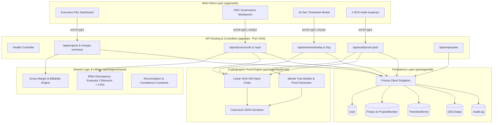
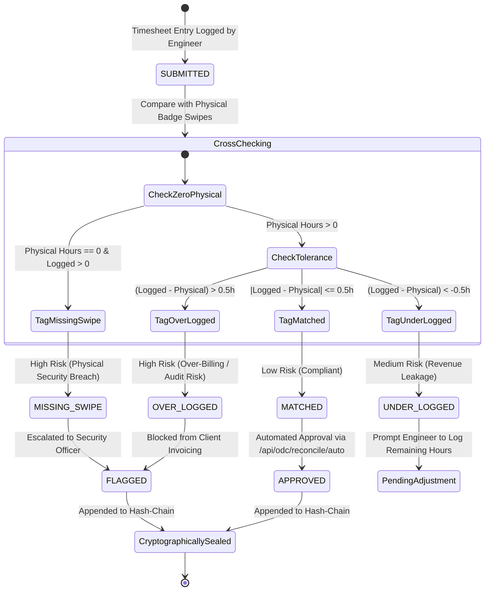
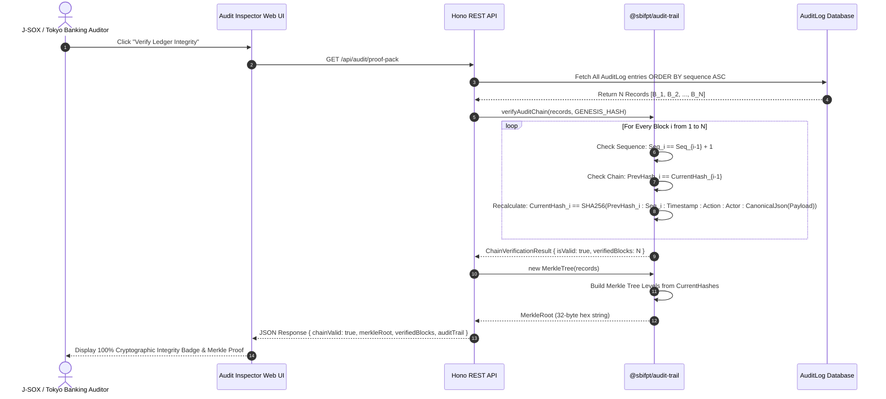

# OpenSpec Architecture & System Design: SBI FPT Innovation Platform

---

## 1. System Topology & Architectural Principles

The SBI FPT Enterprise ODC Delivery Governance Platform is architected as an enterprise monorepo using pnpm workspaces and clean architectural boundaries.

### 1.1 Architectural Decisions & Invariants
1. **Ultra-Lean Runtime Footprint**: Powered by Hono (lightweight HTTP router) rather than heavy enterprise web frameworks, achieving cold starts under 10ms and memory usage below 60MB RAM.
2. **Zero-Trust Auditability**: All operational adjustments, reconciliation runs, and timesheet entries are immutably anchored in a linear SHA-256 hash-chain with genesis block pinning.
3. **Decoupled Cryptographic Core**: The cryptographic hashing and Merkle Tree engines are encapsulated in `@sbifpt/audit-trail`, completely independent of database or HTTP frameworks to allow standalone verification by Tokyo banking auditors.
4. **Shared Type Safety**: All financial formulas, constants, and DTO interfaces are centralized in `@sbifpt/shared` and consumed synchronously by the API and Web client layers.

```
sbifpt/
├── apps/
│   ├── api/                 # High-performance Hono REST API (Port 4100)
│   └── web/                 # Executive & Operational Dashboard (React 19 + Vite)
├── packages/
│   ├── audit-trail/         # Cryptographic SHA-256 Merkle chain & tamper-proof logger
│   ├── db/                  # Prisma ORM singleton, schema & enterprise seed data
│   └── shared/              # Shared types, DTOs, and margin/billability formulas
```

---

## 2. Component & Data Flow Architecture (Mermaid `flowchart TD`)



---

## 3. Reconciliation State Machine (Mermaid `stateDiagram-v2`)



---

## 4. Cryptographic Proof & Verification Sequence (Mermaid `sequenceDiagram`)



---

## 5. Mathematical Formulations & Data Structures

### 5.1 Real-Time Financial Margin Equations
1. **Gross Margin**:
   $$GrossMargin(p) = \frac{\text{Revenue}(p) - \text{Cost}(p)}{\text{Revenue}(p)} \times 100\%$$
   Where:
   - $\text{Revenue}(p) = \sum \left( \text{BillableHours} \times \text{UserBillingRate} \right)$
   - $\text{Cost}(p) = \sum \left( \text{TotalHours} \times \text{UserCostRate} \right)$

2. **Billability Ratio**:
   $$BillabilityRatio = \frac{\text{Billable Hours}}{\text{Total Logged Hours}} \times 100\%$$

3. **Margin Health Classification**:
   - `EXCELLENT`: $\text{Margin} \ge \text{Target} + 5\%$
   - `HEALTHY`: $\text{Target} \le \text{Margin} < \text{Target} + 5\%$
   - `WARNING`: $\text{Target} - 10\% \le \text{Margin} < \text{Target}$
   - `CRITICAL`: $\text{Margin} < \text{Target} - 10\%$

### 5.2 Effort Discrepancy Logic
Let $\Delta = H_{\text{timesheet}} - H_{\text{physical}}$ with tolerance $\epsilon = 0.5\text{h}$:
- If $H_{\text{physical}} = 0$ and $H_{\text{timesheet}} > 0 \implies \text{MISSING\_SWIPE}$ (Violation: `SEC-ODC-001`, High Risk).
- If $\Delta > \epsilon \implies \text{OVER\_LOGGED}$ (Violation: `FIN-WBS-002`, High Risk).
- If $\Delta < -\epsilon \implies \text{UNDER\_LOGGED}$ (Violation: `OPS-REV-003`, Medium Risk).
- Otherwise $\implies \text{MATCHED}$ (Compliant, Low Risk).

### 5.3 Cryptographic Hash-Chain Formula
$$H_n = \text{SHA256}\Big( H_{n-1} \mathbin{\Vert} \text{Seq}_n \mathbin{\Vert} \text{Timestamp}_n \mathbin{\Vert} \text{Action}_n \mathbin{\Vert} \text{ActorId}_n \mathbin{\Vert} \text{Canonicalize}(\text{Payload}_n) \Big)$$
Where $H_0 = \text{"0"}^{64}$.

---

## 6. Security & Performance Invariants

1. **Deterministic Hashing**: Canonical JSON serialization ensures identical key order across V8 and Node runtime engines, preventing spurious hash mismatches.
2. **Sub-50ms API Latency**: In-memory relational queries with composite indexing on `(userId, date)` and `(projectId, date)` maintain API response times well below 50ms.
3. **Immutability Protection**: `AuditLog` records cannot be updated or deleted via application logic; any raw SQL update breaks the sequence and hash-link, instantly detectable via `verifyAuditChain`.
4. **Bilingual Operator Support**: All discrepancy cards render English, Japanese, and Vietnamese remediation instructions directly to PMs and BrSEs.

---
